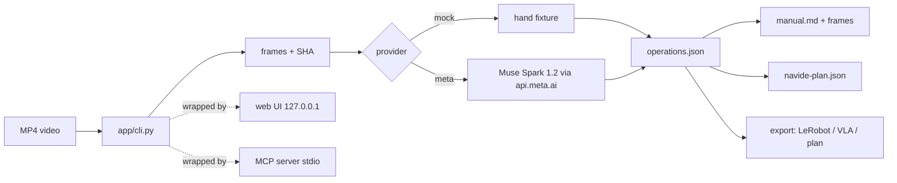

# Watch Once, Teach Human and Robot (Meta Hackathon #6)

Teaching video → 📘 manual for humans + 🤖 JSON for robots.
Built during the Meta hackathon; demo AI is all Meta (Muse Spark, Muse Code).

Watch a demo clip once. Get a human assembly manual with source frames,
a validated 5-field operation JSON (`object/action/target/pre/done`), a
Navide task payload, and robot-ready export annotations — via CLI, local
web UI, or MCP.

## Architecture



Interfaces (`web/`, `mcp_server.py`, `export/`) only wrap the frozen CLI;
core logic and schemas are untouched.

## What this repo contains (built during the event)

- `app/`: video CLI — frame extraction, mock + Meta Muse Spark providers,
  5-field operation JSON validation, Markdown manual, and Navide task
  payload export (+ optional MCP adapter).
- `app/desktop-demo/`: isolated local TODO page + loopback server + recording
  script used for the computer-operation reproduce demo.
- `app/fixtures/`, `app/tests/`: self-made synthetic fixtures and unit tests.
- `app/web/`: minimal local web UI (stdlib only, binds 127.0.0.1): pick a
  video or built-in example → analyze → timeline manual + robot-step cards →
  export previews → Navide payload preview → run history.
- `app/export/`: export layer (LeRobot-style annotation, VLA sequence, plan
  steps). Annotation layer only — no robot states, never run on a real
  robot or VLA.
- `app/mcp_server.py`: MCP server (stdio) exposing the same pipeline to
  agents. Config template: `app/mcp.example.json`.
- Full component doc: `app/README.md`.

Pre-existing external tools (not built here): Navide, Muse CLI/Muse Code,
Meta models and services, FFmpeg/ffprobe, MCP SDK, Python deps.

## Quick start (mock, no API key)

```sh
git clone https://github.com/nt-neil/watch-once-teach-human-and-robot.git
cd watch-once-teach-human-and-robot/app
python3 -m venv .venv
.venv/bin/python -m pip install -r requirements.txt
.venv/bin/python fixtures/make_synthetic.py
.venv/bin/python cli.py runs/synthetic-fixture.mp4 --workspace-path '<workspace>'
```

Full zero-to-running guide (venv, server, mock trial, live inference,
troubleshooting): `app/README.md` → “Run it locally”.

## Run with Meta (.env)

Paid runs need `--provider meta --confirm-paid-api` and `META_API_KEY`:

```sh
cp .env.example .env   # then fill in your key; .env is gitignored
.venv/bin/python cli.py <video.mp4> --workspace-path '<workspace>' \
  --provider meta --confirm-paid-api
```

Only `muse-spark-1.2` / `muse-spark-1.3` are accepted
(`providers.py`); default is 1.2. The key is read from the environment
or `app/.env`, never written to disk or printed. See `app/README.md`.

## Web UI

```sh
cd '<repo>/app'
.venv/bin/python web/server.py --port 18766
# open http://127.0.0.1:18766/ in a browser
```

Mock vs live: the UI defaults to mock (free; results carry a MOCK badge and
come from a hand-written fixture, not from any model). A real Meta inference
only happens when you pick the Meta provider and tick the paid-API checkbox;
the server enforces max 3 calls / US$0.10. The home page shows
`Meta API key: configured / not configured` (status only, never the value).

## MCP

Install once: `.venv/bin/python -m pip install -r requirements-mcp.txt`,
then add to your MCP client (Claude Code / Muse Code `mcpServers`):

```json
{
  "mcpServers": {
    "watch-once": {
      "command": "<repo>/app/.venv/bin/python",
      "args": ["<repo>/app/mcp_server.py"],
      "env": {}
    }
  }
}
```

Tools: `list_examples`, `analyze_video` (mock default; meta needs
`confirm_paid: true` and shares the 3-call / US$0.10 budget),
`get_result`, `export` (`lerobot` / `vla` / `plan`), `list_runs`,
`send_to_navide` (payload preview, not live-connected). Paths are jailed
to `app/` + built-in examples; errors never leak absolute paths or keys.

Navide: run this same server over stdio from a Navide pane — this project
itself was operated that way (pane-relayed MCP; see Execution attribution).

## Export formats

- LeRobot v3-style episode task + subtask annotation JSON (annotation layer
  only — no robot states or action data are fabricated).
- VLA instruction sequence (one short English command per step).
- Plan steps with pre/done conditions (for behavior-tree / PDDL-style
  executors).

Wording guarantee: “format-aligned, input-ready annotations” — we do not
claim any run on a real robot or VLA. Schemas in `app/export/schemas/`,
samples in `app/export/samples/`.

## Verified boundaries (read before reusing)

- Only the M1 single demo is verified 4/4 at baseline; time precision is
  claimed from that clip only. A same-day re-run split it into 2 steps, so
  split granularity is unstable and must be re-verified per run.
- W1-class continuous fine motion (identity tracking) and L3-class
  adjacent-step merging are documented limitations; granularity hints split
  steps but induce even time-splitting, so L3 timing is not claimed.
- Desktop-demo reproduce was stopped after two misses (timing + CJK OCR);
  no third inference was run. See the demo video for the honest-boundaries
  segment.
- Physical assembly is never executed (no robot arm). The closed loop covers
  software artifacts only (assembly checklist); physical todos stay pending.
- Navide plans were created via pane-relayed MCP; the standalone adapter has
  never been live-verified. Observed API spend ≈ US$0.22 + US$0.60 reserves
  as of 2026-11-03 (usage-rate estimates, not bill reconciliation).
- Web UI + export + MCP test evidence: backend 69 pass, live e2e 18/18,
  unit suite 24/24, sha256 zero unexpected drift, 11 design-review rounds +
  real-browser walkthroughs (one paid Meta run).
- Raw evidence: `app/evidence/` — 4 runs (real-smoke 10/30, checklist loop,
  M1 re-run, UI live run) with operations/manual (or checklist), provider
  result with model id + usage, cost report, safe request/response, and
  320px frame thumbnails. Keys and provider private ids redacted.

## Sources and attribution

- M1: "AIST 0001" from the AIST Bimanual Manipulation Dataset —
  Tomohiro Motoda, Masaki Murooka, Ryoichi Nakajo, Muhammad A. Muttaqien,
  Koshi Makihara, Hanbit Oh, Keisuke Shirai, Floris Erich, Ryo Hanai,
  Yukiyasu Domae; © 2025 AIST; CC BY 4.0
  (https://creativecommons.org/licenses/by/4.0/);
  source https://aistairc.github.io/aist_bimanip_site/ ;
  clip used uncut, no endorsement implied.
- W1: Jiayun Zhang, Petr Byvshev, Yu Xiao (2020),
  "A video dataset for wooden box assembly",
  https://doi.org/10.5281/zenodo.4047982 , CC BY 4.0; excerpt 125–172s of
  the original, re-encoded without audio; no endorsement implied.
- L3/L4: Elina Mäntylä, Teemu O. Ihalainen (2021), Brick Strex,
  https://doi.org/10.1038/s41598-021-97900-5 , CC BY 4.0; video photography
  credit Jukka Lehtiniemi, Markus Hannula; excerpts only, no speed claims.
- Category 4: self-recorded screen demo, no third-party license involved.

## Execution attribution

- Model inference: 100% Meta Muse Spark via api.meta.ai. One MiniMax video
  read was made during development, discarded, and never entered any GT,
  score, product, or deliverable.
- Produced by Muse Code: M1 checklist + execution report, bridge design,
  demo storyboard, recording script, this repo's staging and top docs, repo
  creation, the M1 dismantle re-run, the local web UI + export layer, the
  MCP server, the test report, and all independent acceptance checks.
- Executed in Codex panes (pre-handover and crew work): app CLI skeleton and
  tests, all data-collection runs and scoring reports, materials survey, and
  Navide plan operations.

## License

MIT — see `LICENSE`.
