# M1 組裝檢查表

「AIST 0001 雙墊圈上軸 — AIST Bimanual Manipulation Dataset」，作者 Tomohiro Motoda、Masaki Murooka、Ryoichi Nakajo、Muhammad A. Muttaqien、Koshi Makihara、Hanbit Oh、Keisuke Shirai、Floris Erich、Ryo Hanai、Yukiyasu Domae；© 2025 AIST。依 [CC BY 4.0](https://creativecommons.org/licenses/by/4.0/) 使用。[資料集／授權來源](https://aistairc.github.io/aist_bimanip_site/)；[原始 MP4](https://aistairc.github.io/aist_bimanip_site/statics/video/0001_task_video.mp4)。不表示作者或 AIST 背書本作品。

concept.done 僅為來源引用，不表示本次實體完成；source frames 不是完成證據。

## 1. step-01

- start_ms: 0
- end_ms: 3500
- object: right robotic gripper
- action: approaches and picks
- target: upper small round part (type uncertain, possibly nut)
- pre: two small round parts resting on teal surface to right of metal plate with two studs, gripper open and away
- done: gripper grasped small round part and lifted from surface - seating/ grasp verified by part no longer on surface, secure hold unverified

**未知／待人工確認**

來源描述含不確定文字，須由人工核對影片與實體後確認，本表不作真實性斷言。

- [ ] 人工核對

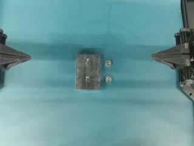
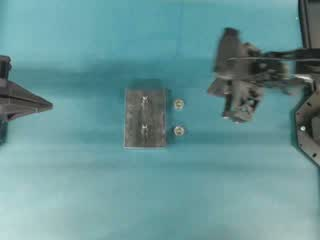
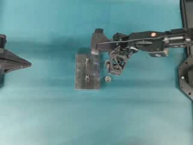
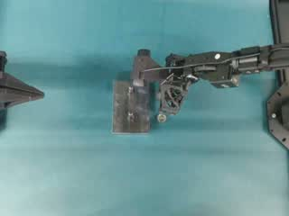

## 2. step-02

- start_ms: 3500
- end_ms: 7000
- object: right robotic gripper holding small round part (type uncertain)
- action: transports and positions onto
- target: upper stud on rectangular metal plate
- pre: gripper holding small round part above surface, upper stud of metal plate exposed
- done: small round part appears positioned over/on upper stud of metal plate, final seating/tightening unverified due to occlusion and low resolution

**未知／待人工確認**

來源描述含不確定文字，須由人工核對影片與實體後確認，本表不作真實性斷言。

- [ ] 人工核對

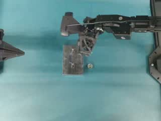
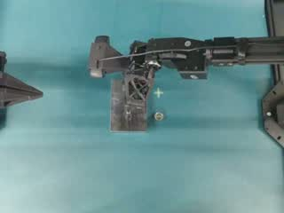
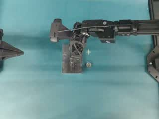

## 3. step-03

- start_ms: 7000
- end_ms: 10500
- object: right robotic gripper
- action: repositions and picks
- target: remaining small round part (type uncertain, possibly nut) on surface
- pre: one small round part remaining on teal surface to right of plate, one part possibly on upper stud (uncertain), gripper moved away from plate
- done: gripper grasped second small round part and lifted from surface, secure hold unverified

**未知／待人工確認**

來源描述含不確定文字，須由人工核對影片與實體後確認，本表不作真實性斷言。

- [ ] 人工核對

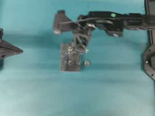
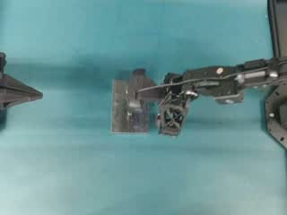
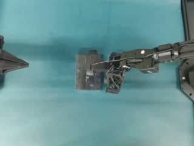
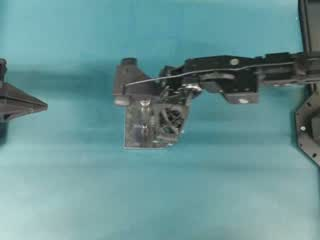

## 4. step-04

- start_ms: 10500
- end_ms: 14000
- object: right robotic gripper holding small round part (type uncertain)
- action: transports and positions onto
- target: lower stud on rectangular metal plate
- pre: gripper holding second small round part above surface, lower stud of metal plate exposed
- done: small round part appears positioned over/on lower stud of metal plate, final seating/tightening unverified due to occlusion and low resolution

**未知／待人工確認**

來源描述含不確定文字，須由人工核對影片與實體後確認，本表不作真實性斷言。

- [ ] 人工核對

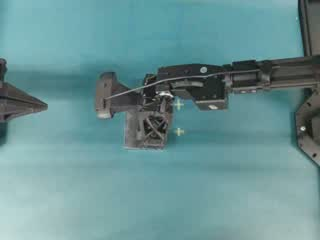
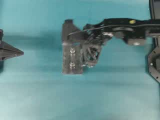

本表由 Muse Code 依 JSON 產生，未操作機器人。