# 操作手冊 [META — 模型輸出，待人工核對]

來源：0001_task_video.mp4
SHA256：`33e23ee7a91cfde0f862f51675cc8315cb13e529617eda59a1da6e4acc09bf3d`；來源時長：14000.0 ms

素材署名（M1 attribution_template 原文）：

「AIST 0001 雙墊圈上軸 — AIST Bimanual Manipulation Dataset」，Tomohiro Motoda, Masaki Murooka, Ryoichi Nakajo, Muhammad A. Muttaqien, Koshi Makihara, Hanbit Oh, Keisuke Shirai, Floris Erich, Ryo Hanai, Yukiyasu Domae; © 2025 AIST；CC BY 4.0 https://creativecommons.org/licenses/by/4.0/ ；原片 https://aistairc.github.io/aist_bimanip_site/statics/video/0001_task_video.mp4 ；已剪輯（選段0–14秒，保留全長、僅轉碼，不變速）；不表示作者背書。

引用來源：`materials-survey/continuation/selected-app-sources.json` → `selected[id=M1].attribution_template`。

本次處理說明：上述素材模板描述準備好的選段檔；這次 CLI 實際使用 `local_original` 的 `research/samples/0001_task_video.mp4`，完整上傳原始 14 秒檔案，未另剪輯、轉碼或變速；手冊圖片僅抽幀與縮放。來源無音軌。

這份手冊由同一份操作概念 JSON 產生。未接 SAM；圖像是原片抽幀，未生成追蹤或重畫結果。
時間區間是觀察範圍；end_ms 不代表已證實的精確完成時間，done 仍須人工核對。
由外層人工判斷物理/軟體步驟及執行權限；本次沒有 agent 派工或設備控制。

## step-01 · 0–3500 ms

- **action**：approaches and picks
- **done**：gripper grasped small round part and lifted from surface - seating/ grasp verified by part no longer on surface, secure hold unverified
- **object**：right robotic gripper
- **pre**：two small round parts resting on teal surface to right of metal plate with two studs, gripper open and away
- **target**：upper small round part (type uncertain, possibly nut)

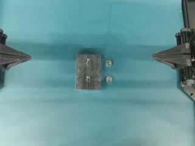

`frame-000001` → decoder frame 0, PTS 0 (time_base 1/12800), sample 0.0 ms

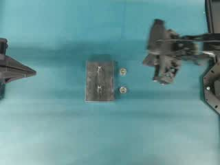

`frame-000002` → decoder frame 50, PTS 12800 (time_base 1/12800), sample 1000.0 ms

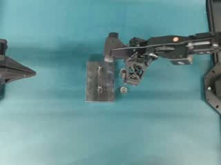

`frame-000003` → decoder frame 100, PTS 25600 (time_base 1/12800), sample 2000.0 ms

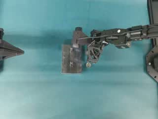

`frame-000004` → decoder frame 150, PTS 38400 (time_base 1/12800), sample 3000.0 ms

## step-02 · 3500–7000 ms

- **action**：transports and positions onto
- **done**：small round part appears positioned over/on upper stud of metal plate, final seating/tightening unverified due to occlusion and low resolution
- **object**：right robotic gripper holding small round part (type uncertain)
- **pre**：gripper holding small round part above surface, upper stud of metal plate exposed
- **target**：upper stud on rectangular metal plate

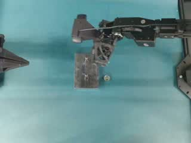

`frame-000005` → decoder frame 200, PTS 51200 (time_base 1/12800), sample 4000.0 ms

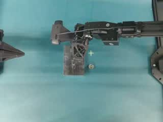

`frame-000006` → decoder frame 250, PTS 64000 (time_base 1/12800), sample 5000.0 ms

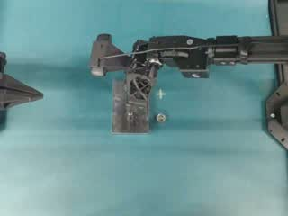

`frame-000007` → decoder frame 300, PTS 76800 (time_base 1/12800), sample 6000.0 ms

## step-03 · 7000–10500 ms

- **action**：repositions and picks
- **done**：gripper grasped second small round part and lifted from surface, secure hold unverified
- **object**：right robotic gripper
- **pre**：one small round part remaining on teal surface to right of plate, one part possibly on upper stud (uncertain), gripper moved away from plate
- **target**：remaining small round part (type uncertain, possibly nut) on surface

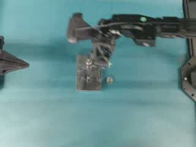

`frame-000008` → decoder frame 350, PTS 89600 (time_base 1/12800), sample 7000.0 ms

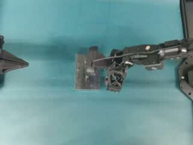

`frame-000009` → decoder frame 400, PTS 102400 (time_base 1/12800), sample 8000.0 ms

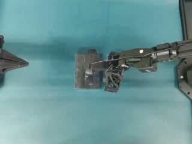

`frame-000010` → decoder frame 450, PTS 115200 (time_base 1/12800), sample 9000.0 ms

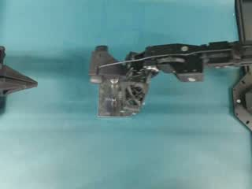

`frame-000011` → decoder frame 500, PTS 128000 (time_base 1/12800), sample 10000.0 ms

## step-04 · 10500–14000 ms

- **action**：transports and positions onto
- **done**：small round part appears positioned over/on lower stud of metal plate, final seating/tightening unverified due to occlusion and low resolution
- **object**：right robotic gripper holding small round part (type uncertain)
- **pre**：gripper holding second small round part above surface, lower stud of metal plate exposed
- **target**：lower stud on rectangular metal plate

`frame-000012` → decoder frame 550, PTS 140800 (time_base 1/12800), sample 11000.0 ms

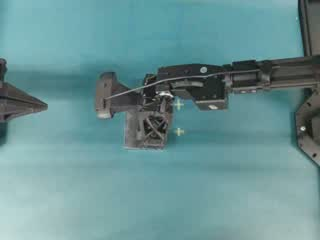

`frame-000013` → decoder frame 600, PTS 153600 (time_base 1/12800), sample 12000.0 ms

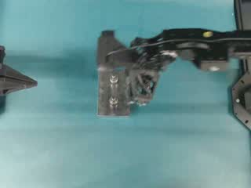

`frame-000014` → decoder frame 650, PTS 166400 (time_base 1/12800), sample 13000.0 ms
