# 操作手冊 [META — 模型輸出，待人工核對]

來源：1793704202_0001_task_video.mp4
SHA256：`33e23ee7a91cfde0f862f51675cc8315cb13e529617eda59a1da6e4acc09bf3d`；來源時長：14000.0 ms

這份手冊由同一份操作概念 JSON 產生。未接 SAM；圖像是原片抽幀，未生成追蹤或重畫結果。
時間區間是觀察範圍；end_ms 不代表已證實的精確完成時間，done 仍須人工核對。
由外層人工判斷物理/軟體步驟及執行權限；本次沒有 agent 派工或設備控制。

## step-001 · 800–3800 ms

- **action**：pick
- **done**：small round part held off teal surface in closed right gripper visible in cited frames; complete lift unverified beyond held position
- **object**：small round part
- **pre**：small round part resting on teal surface to right of rectangular plate, right gripper open and to the right
- **target**：teal work surface to right of rectangular plate
- **evidence**：In frames frame-000002, frame-000003, frame-000004 the right gripper moves left from the right edge toward the upper small round part on the teal surface, closes around it and lifts it; at frame-000004 the part is no longer on the table and is held in the closed right gripper while the left gripper remains open and idle.

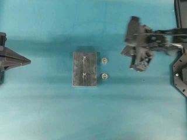

`frame-000002` → decoder frame 50, PTS 12800 (time_base 1/12800), sample 1000.0 ms

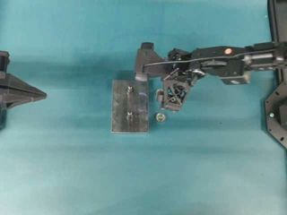

`frame-000003` → decoder frame 100, PTS 25600 (time_base 1/12800), sample 2000.0 ms

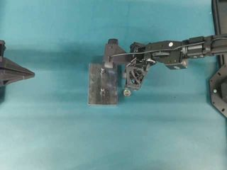

`frame-000004` → decoder frame 150, PTS 38400 (time_base 1/12800), sample 3000.0 ms

## step-002 · 3800–7500 ms

- **action**：place
- **done**：small round part resting on one stud of rectangular plate with right gripper open and clear, visible in cited frames; tightening/securing unverified
- **object**：small round part
- **pre**：small round part held in closed right gripper above teal surface
- **target**：upper stud on rectangular plate (stud nearest top of frame, orientation uncertain)
- **evidence**：In frames frame-000005, frame-000006, frame-000007, frame-000008 the right gripper carrying the small round part moves left over the rectangular plate, lowers onto the upper stud and then opens; at frame-000008 the part is seen on the upper stud and the right gripper is open and beginning to retract, with one small round part remaining on the table.

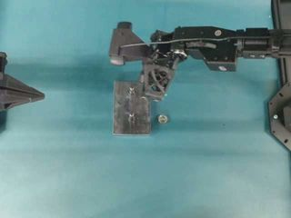

`frame-000005` → decoder frame 200, PTS 51200 (time_base 1/12800), sample 4000.0 ms

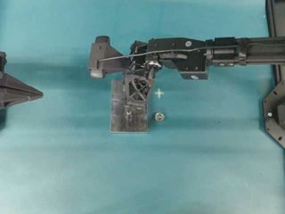

`frame-000006` → decoder frame 250, PTS 64000 (time_base 1/12800), sample 5000.0 ms

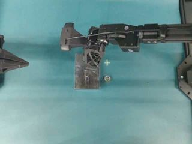

`frame-000007` → decoder frame 300, PTS 76800 (time_base 1/12800), sample 6000.0 ms

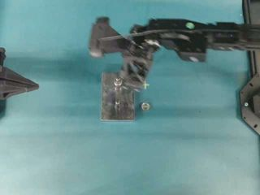

`frame-000008` → decoder frame 350, PTS 89600 (time_base 1/12800), sample 7000.0 ms

## step-003 · 7500–10500 ms

- **action**：pick
- **done**：second small round part held off teal surface in closed right gripper visible in cited frames; complete lift unverified beyond held position
- **object**：small round part
- **pre**：one small round part remaining on teal surface to right of rectangular plate, one small round part already on rectangular plate stud, right gripper open
- **target**：teal work surface to right of rectangular plate
- **evidence**：In frames frame-000009, frame-000010, frame-000011 the right gripper moves right away from the plate toward the remaining small round part on the teal surface, closes around it and lifts it; at frame-000011 the table position is empty and the part is held in the closed right gripper.

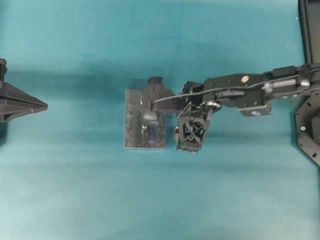

`frame-000009` → decoder frame 400, PTS 102400 (time_base 1/12800), sample 8000.0 ms

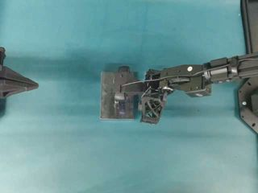

`frame-000010` → decoder frame 450, PTS 115200 (time_base 1/12800), sample 9000.0 ms

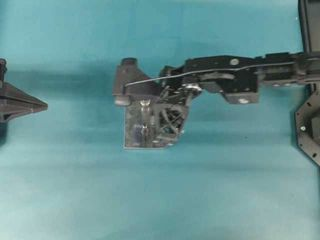

`frame-000011` → decoder frame 500, PTS 128000 (time_base 1/12800), sample 10000.0 ms

## step-004 · 10500–14000 ms

- **action**：place
- **done**：small round part resting on remaining stud of rectangular plate with right gripper open and clear, visible in cited frames; tightening/securing unverified
- **object**：small round part
- **pre**：second small round part held in closed right gripper above teal surface
- **target**：lower stud on rectangular plate (stud nearest bottom of frame, orientation uncertain)
- **evidence**：In frames frame-000012, frame-000013, frame-000014 the right gripper carrying the second small round part moves left over the rectangular plate, lowers onto the remaining lower stud and then opens; at frame-000014 both studs of the rectangular plate have a small round part resting on them and the right gripper is open and retracted to the right.

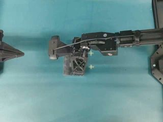

`frame-000012` → decoder frame 550, PTS 140800 (time_base 1/12800), sample 11000.0 ms

`frame-000013` → decoder frame 600, PTS 153600 (time_base 1/12800), sample 12000.0 ms

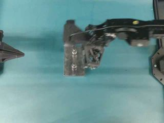

`frame-000014` → decoder frame 650, PTS 166400 (time_base 1/12800), sample 13000.0 ms
